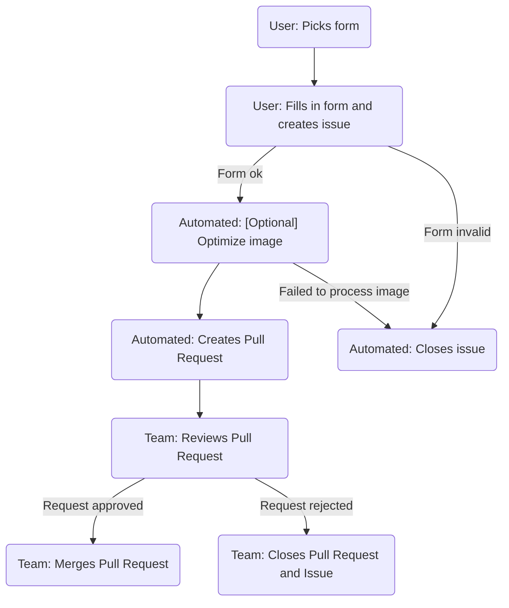

# Token Lists

CoW Swap default token lists and token image repository

## Managing the tokens

The process has been automated, and it's now much simpler.
The forms are self-explanatory and should contain all the info you need to proceed.

**Notes**:

- Images will be optimized in the background
- If you want to add a token/image to multiple networks, create one issue per network

Head to the [issues section](https://github.com/cowprotocol/token-lists/issues/new/choose) and pick your action:

### Add or update token

For adding tokens to CoW Swap's default token list, or to update an existing one, use the [`Add Token` form](https://github.com/cowprotocol/token-lists/issues/new?assignees=&labels=addToken&projects=&template=1-addTokenForm.yml&title=%5BAddToken%5D+%60SYMBOL%60+on+%60NETWORK%60).

### Remove token from the list

Use the [`Remove Token` form](https://github.com/cowprotocol/token-lists/issues/new?assignees=&labels=removeToken&projects=&template=3-removeTokenForm.yml&title=%5BRemoveToken%5D+%60SYMBOL%60+on+%60NETWORK%60).

Even though the token is removed from the default list, its image will be kept.

### Add or update image only

Not all tokens should be in the default token list, but the more token images we have the better UX.

For this, use the [`Add Image` form](https://github.com/cowprotocol/token-lists/issues/new?assignees=&labels=addImage&projects=&template=2-addImageForm.yml&title=%5BAddImage%5D+%60SYMBOL%60+on+%60NETWORK%60).

### Flow overview



## Development

Instructions for setting up and running the various scripts locally

### Setup

### Prerequisites

Requires Node.js 22.9 or later (CI uses the current LTS)

```bash
# Install dependencies
yarn

# Generate Coingecko list
yarn coingecko
```

### Download images (deprecated)

There's a script that will fetch all images from the CowSwap list and store them in `src/public/images/<chainId>/<address>.png`

```bash
yarn downloadImages
```

### Generating Auxiliary Token Lists

To generate updated token lists from Coingecko and Uniswap:

```bash
yarn generateAuxLists
```

This script fetches and processes token data from both Coingecko and Uniswap APIs to create auxiliary token lists. These lists are used to enhance token metadata and support across different networks.

- Coingecko lists contain up to the top 500 tokens per chain, sorted by volume
- RWA lists (`CoinGeckoRwa.<chainId>.json`, `yarn rwaLists` alone) contain every tokenized real-world asset CoinGecko knows about, from any issuer, sorted by market cap:
  - stocks, ETFs and commodities of the [CoinGecko RWA API](https://docs.coingecko.com/reference/rwa-overview)
  - coins of the asset categories in `RWA_CATEGORIES` (`src/scripts/auxLists/rwa.ts`) that the RWA API misses: treasuries, money market funds, credit, non-US stocks...
  - Each token carries `extensions.assetType` (`stock`, `etf`, `commodity`, `bond`, `fund`, `credit`, `deposit` or `other`) and, for RWA API tokens, `extensions.issuer`
- Uniswap lists are a combination of:
  - Token for given chain already existing in the default Uniswap list
  - Mainnet tokens, mapped to the target chain, via Coingecko api

The version and timestamp are bumped according to [token list standard](https://github.com/Uniswap/token-lists?tab=readme-ov-file#semantic-versioning).

#### Required Environment Variables

- `COINGECKO_API_KEY`: Your Coingecko API key (required for API access)

#### Generated Files

The script generates token list files in `src/public/` for the following networks:

- Ethereum (CoinGecko.1.json)
- Arbitrum (CoinGecko.42161.json, Uniswap.42161.json)
- Avalanche (CoinGecko.43114.json, Uniswap.43114.json)
- Base (CoinGecko.8453.json, Uniswap.8453.json)
- BNB (CoinGecko.56.json, Uniswap.56.json)
- Gnosis Chain (CoinGecko.100.json, Uniswap.100.json)
- Linea (CoinGecko.59144.json, Uniswap.59144.json)
- Plasma (CoinGecko.9745.json, Uniswap.9745.json)
- Ink (CoinGecko.57073.json, Uniswap.57073.json)
- Robinhood Chain (CoinGecko.4663.json, Uniswap.4663.json)
- Polygon (CoinGecko.137.json, Uniswap.137.json)

### Solana lists

Each week, `yarn solana --refresh-rankings` runs one paid [Dune query](https://dune.com/queries/9087267) and generates `TokenRanking.1000000001.json` from 90-day and 30-day trading volumes. The weekly workflow opens a PR with this file for review.

The paid execution is saved as a receipt artifact. If the run fails after starting the query, or main's membership changes before the proposal is merged, run **Refresh Solana Rankings** manually with `execution_id` and `receipt_run_id` (the ranking PR body lists both; for a failed run, use its run ID and the `Dune execution:` line from its log). It re-reads the same execution against current main without paying again. Dune results older than 7 days are rejected, so this only works until the next weekly run.

Each day, the workflow runs `yarn solana` on `main` to rebuild `CowSwap.1000000001.json` using the last merged ranks from `TokenRanking.1000000001.json`. It adds and removes tokens using Jupiter safety checks and CoinGecko pricing support, updates token metadata, and refreshes the separate RWA list and Jupiter Shield warnings. Tokens without ranks remain listed. Daily runs do not call Dune. Failed runs are not published.

Run either command locally. `yarn solana` uses the ranking file in your checkout, including any unmerged changes.

The first `TokenRanking.1000000001.json` is a bootstrap rather than a Dune result: it carries
`queryId: 8910905`, the retired per-run query, and the ranks it holds are the ones already published
in `CowSwap.1000000001.json`, so no credits were spent creating it. `--validate` enforces that — on
a base with no snapshot yet, a candidate may only import ranks the published list already carries.
The first weekly refresh replaces it with a real execution of query 9087267.

```bash
# Generate a weekly ranking proposal
DUNE_API_KEY='<key>' yarn solana --refresh-rankings
# Rebuild the lists and warnings using the current ranking file
yarn solana
```

The daily run refuses to publish a token list or a warnings file that shrinks by more than 30% in
one go, since that reads as a provider outage rather than hundreds of tokens going bad at once —
override with `ALLOW_LIST_SHRINK=1` and `ALLOW_WARNINGS_SHRINK=1` respectively for a deliberate
purge. Shield is asked for 30 mints at a time and the run aborts if a response covers fewer mints
than it asked for, because a dropped mint is indistinguishable from a clean one.

Ranks are published even once the weekly refresh is overdue: last week's order beats no order.
`yarn solana --check-ranking` is the part that complains — it runs as its own daily job and fails,
opening an issue, when the approved ranks are more than two weeks old.

`TokenWarnings.1000000001.json` stores Jupiter Shield warnings by token address using short codes (`MINT`, `FREEZE`, `PERM_DEL`, `CONCENTRATED`, `LOW_LIQ`, `LOW_ORGANIC`, `LOW_VOLUME`, `UNVERIFIED`, `NO_SELL`). The `types` dictionary stores each code's severity and message once. Each successful daily run removes warnings that Jupiter no longer reports.

```jsonc
{
  "types": { "FREEZE": { "severity": "warning", "message": "The authority's owner can freeze…" } },
  "warnings": { "EPjFWdd5AufqSSqeM2qN1xzybapC8G4wEGGkZwyTDt1v": ["FREEZE", "MINT"] }
}
```

### Adding a new network

To support a new network (e.g. Ink, chain ID 57073), run these steps in order:

1. **Generate auxiliary token lists** for the new chain (the chain must already be in `COINGECKO_CHAINS` in `src/scripts/auxLists/utils.ts`):

   ```bash
   COINGECKO_API_KEY=your_key yarn generateAuxLists
   ```

   This creates `src/public/CoinGecko.<chainId>.json` and `src/public/Uniswap.<chainId>.json` for the new network.

2. **Fetch permit info** for the new chain. The default token list (`CowSwap.json`) will not include tokens for new networks yet if you haven't added any, so you must pass the path to the chain-specific list as the **second** argument:

   ```bash
   yarn run fetchPermitInfo -- <chainId> CoinGecko.<chainId>.json
   ```

   Example for Ink:

   ```bash
   yarn run fetchPermitInfo -- 57073 CoinGecko.57073.json
   ```

   Without the second argument, the script would use `CowSwap.json` and skip all tokens (they would have the wrong chainId), leaving the permit file empty.

3. **Include only the new network's files in your PR.** The scripts above may have updated files for other networks too; do not include those changes, as they are updated daily by a cron job.
